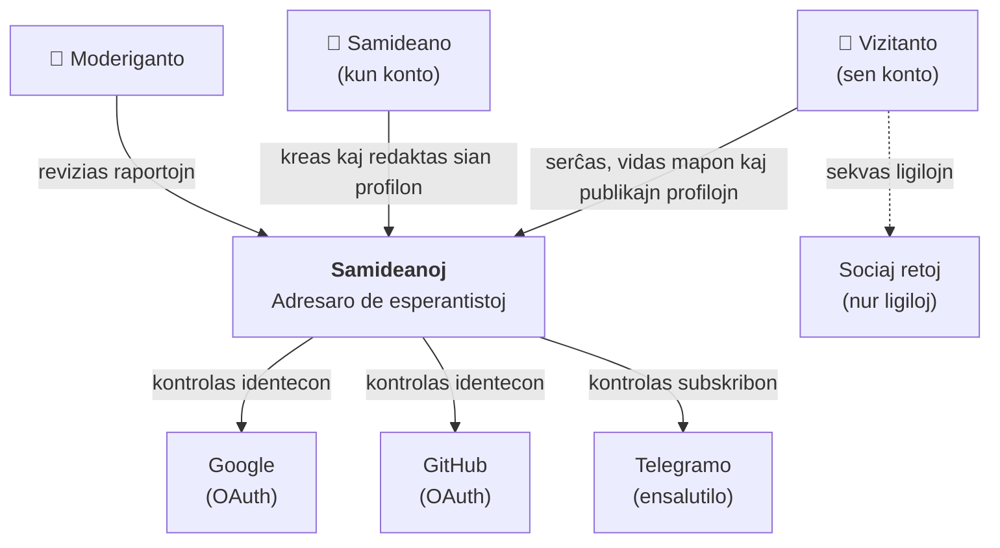
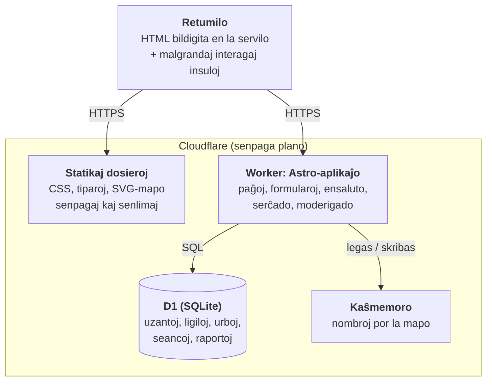
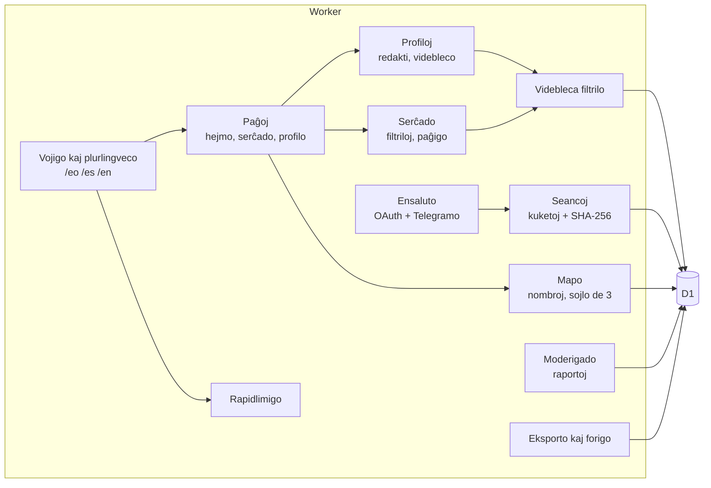

# Arkitekturo

- **Stato:** Skizo por diskuto
- **Dato:** 2026-11-27
- **Decidoj:** [ADR 0002](../adr/0002-gastigado-kaj-datumbazo.md) (gastigado), [ADR 0003](../adr/0003-kadro.md) (kadro), [ADR 0004](../adr/0004-ensaluto-kaj-seancoj.md) (ensaluto)

La tuta sistemo estas **unu Worker de Cloudflare kun unu datumbazo D1**. Neniu alia servilo, neniu pagata servo.

## Nivelo 1: Kunteksto

Kiu uzas la sistemon kaj kun kiuj eksteraj sistemoj ĝi parolas.

Samideanoj **ne parolas** kun la sociaj retoj: ĝi nur montras ligilojn. Ne ekzistas API-integriĝoj kiuj povus rompiĝi.

## Nivelo 2: Ujoj

| Ujo | Respondeco | Teknologio |
| --- | --- | --- |
| Statikaj dosieroj | CSS, tiparoj, bildoj, la SVG-mapo de la mondo | Cloudflare Workers Static Assets |
| Worker | Bildigas paĝojn, traktas formularojn kaj ensaluton | Astro + TypeScript |
| D1 | Ĉiuj konstantaj datumoj | SQLite, laŭ la [datummodelo](datummodelo.md) |
| Kaŝmemoro | Antaŭkalkulitaj nombroj por la mapo | Cache API de Workers |

## Nivelo 3: Komponantoj de la Worker

**La videbleca filtrilo estas la plej grava komponanto.** Ĉiu datumo de profilo, kiu eliras el la servilo, pasas tra ĝi: ĝi forigas la kampojn, kiujn la rigardanto ne rajtas vidi. Neniu paĝo legas profilojn rekte el D1. Tiel unu sola loko garantias la privatecon, kaj unu aro de testoj kontrolas ĝin.

## Deplojo

- La deplojo uzas `wrangler` kun ĵetono konservita en la sekretoj de GitHub.
- La migradoj de D1 estas versiigitaj en la deponejo kaj aplikataj dum la deplojo.
- Se GitHub Actions malŝaltiĝas pro neaktiveco, **la retejo daŭre funkcias**: Actions servas nur por deploji, ne por funkciigi.
