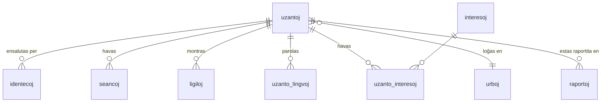

# Datummodelo — skizo

- **Stato:** Skizo por diskuto
- **Dato:** 2026-11-27
- **Datumbazo:** Cloudflare D1 (SQLite), laŭ [ADR 0002](../adr/0002-gastigado-kaj-datumbazo.md)

## Principoj

1. **Minimumaj datumoj.** Ni ne konservas la retpoŝton nek la nomon, kiujn Google, GitHub aŭ Telegramo sendas dum la ensaluto; nur la identigilon de la ekstera konto.
2. **Videbleco por ĉiu kampo.** Ĉiu persona kampo havas sian propran nivelon: `publika`, `ensalutintoj` aŭ `kasxita`.
3. **Loko nur je urba nivelo.** Neniu koordinato de la persono; la mapo uzas la koordinatojn de la urbo.
4. **Facila eksporto kaj forigo.** Ĉiuj datumoj de uzanto ligiĝas al ties `id` kun `ON DELETE CASCADE`.

## Tabeloj

### `uzantoj`

| Kolumno | Tipo | Noto |
| --- | --- | --- |
| `id` | TEXT PK | ULID |
| `slug` | TEXT UNIQUE | Por la konstanta adreso de la profilo (`/s/<slug>`) |
| `kromnomo` | TEXT | Deviga, ĉiam publika |
| `priskribo` | TEXT | Maksimume 500 signoj |
| `nivelo` | TEXT | `komencanto`, `progresanto`, `flua`, `denaska` |
| `urbo_id` | INTEGER FK → `urboj` | Nedeviga |
| `vid_urbo` | TEXT | Videbleco de la urbo |
| `vid_priskribo` | TEXT | Videbleco de la priskribo |
| `vid_lingvoj` | TEXT | Videbleco de la lingvoj |
| `vid_interesoj` | TEXT | Videbleco de la interesoj |
| `rolo` | TEXT | `uzanto`, `moderiganto`, `administranto` |
| `stato` | TEXT | `aktiva`, `kasxita_de_moderiganto`, `neaktiva` |
| `kreita` | INTEGER | Unix-tempo |
| `gxisdatigita` | INTEGER | Montrata kiel "laste ĝisdatigita" (S3) |
| `lasta_ensaluto` | INTEGER | Por kaŝi forlasitajn profilojn (S4) |

La nivelo kaj la lando de la urbo estas ĉiam publikaj, ĉar ili estas la bazo de la serĉado.

### `identecoj`

| Kolumno | Tipo | Noto |
| --- | --- | --- |
| `uzanto_id` | TEXT FK | |
| `provizanto` | TEXT | `telegramo`, `google`, `github` |
| `ekstera_id` | TEXT | Identigilo ĉe la provizanto |
| | | UNIQUE (`provizanto`, `ekstera_id`) |

Unu uzanto povas ligi plurajn identecojn, ekzemple Telegramon kaj Google.

### `seancoj`

| Kolumno | Tipo | Noto |
| --- | --- | --- |
| `id_hash` | TEXT PK | SHA-256 de la seanca ĵetono; la ĵetono mem neniam estas konservata |
| `uzanto_id` | TEXT FK | |
| `eksvalidigxo` | INTEGER | |

### `ligiloj`

| Kolumno | Tipo | Noto |
| --- | --- | --- |
| `id` | INTEGER PK | |
| `uzanto_id` | TEXT FK | |
| `tipo` | TEXT | Vidu la liston sube |
| `valoro` | TEXT | Uzantnomo, ligilo aŭ adreso, validigita laŭ la tipo |
| `videbleco` | TEXT | `publika`, `ensalutintoj`, `kasxita` |
| `ordo` | INTEGER | Ordo de montrado |

**Tipoj en versio 1:**

| Grupo | Tipoj | Defaŭlta videbleco |
| --- | --- | --- |
| Mesaĝiloj | `telegramo`, `whatsapp`, `signal`, `discord` | `ensalutintoj` |
| Sociaj retoj | `mastodon`, `instagram`, `fejsbuko`, `x`, `bluesky`, `youtube`, `tiktok` | `publika` |
| Esperanto | `lernu`, `pasporta_servo`, `amikumu` | `publika` |
| Retejo kaj retpoŝto | `retejo`, `retposxto` | `retejo`: `publika`; `retposxto`: `ensalutintoj` |

WhatsApp kaj Signal estas telefonnumeroj, kaj retpoŝto estas sentema datumo; tial ilia defaŭlta videbleco estas `ensalutintoj`.

### `urboj`

| Kolumno | Tipo | Noto |
| --- | --- | --- |
| `id` | INTEGER PK | Identigilo de GeoNames |
| `nomo` | TEXT | |
| `nomo_eo` | TEXT | Esperanta nomo, se ĝi ekzistas |
| `lando_kodo` | TEXT | ISO 3166-1 alfa-2 |
| `lat`, `lon` | REAL | Koordinatoj de la urbo, ne de la persono |

Fonto: urbo-listo de [GeoNames](https://www.geonames.org/) (permesilo CC BY 4.0; postulas atribuon).

### `interesoj` kaj `uzanto_interesoj`

Antaŭdifinita listo de interesoj (muziko, literaturo, vojaĝoj, programado, ktp.), kun tradukoj. Uzantoj elektas el la listo; ili ne kreas novajn, por eviti spamon kaj duoblaĵojn.

### `uzanto_lingvoj`

`uzanto_id` + `lingvo_kodo` (ISO 639-1). Esperanto estas implicita.

### `raportoj`

| Kolumno | Tipo | Noto |
| --- | --- | --- |
| `id` | INTEGER PK | |
| `profilo_id` | TEXT FK → `uzantoj` | La raportita profilo |
| `raportanto_id` | TEXT FK → `uzantoj` | Nur ensalutintoj povas raporti |
| `kialo` | TEXT | `spamo`, `falsa_profilo`, `ofenda_enhavo`, `alia` |
| `komento` | TEXT | Nedeviga |
| `stato` | TEXT | `nova`, `akceptita`, `malakceptita` |
| `kreita` | INTEGER | |

## Publika mapo kaj privateco

La mapo montras la nombron de samideanoj por ĉiu urbo. Por ke ĝi ne malkaŝu individuojn:

- Oni kalkulas nur profilojn kun `vid_urbo = 'publika'` kaj `stato = 'aktiva'`.
- **Urbo kun malpli ol 3 samideanoj ne aperas aparte**: ĝiaj samideanoj estas kalkulataj nur en la tuto de la lando.
- La nombroj estas antaŭkalkulataj kaj konservataj en kaŝmemoro, por ne legi la tutan tabelon ĉe ĉiu vizito.

## Malfermaj demandoj

- [ ] Ĉu permesi profilon sen urbo (nur lando)?
- [ ] Kiu estas la komenca listo de interesoj?
- [ ] Ĉu la `slug` estas elektebla de la uzanto aŭ aŭtomate kreita el la kromnomo?
