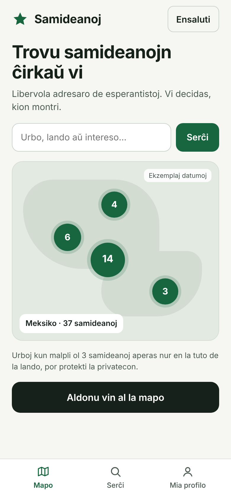
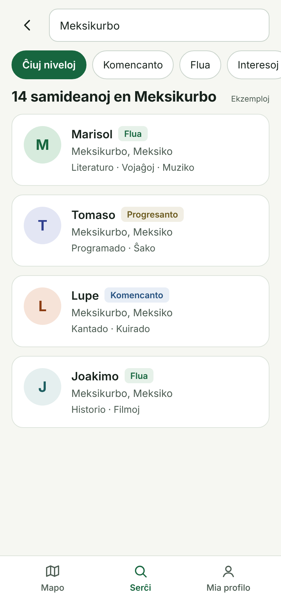
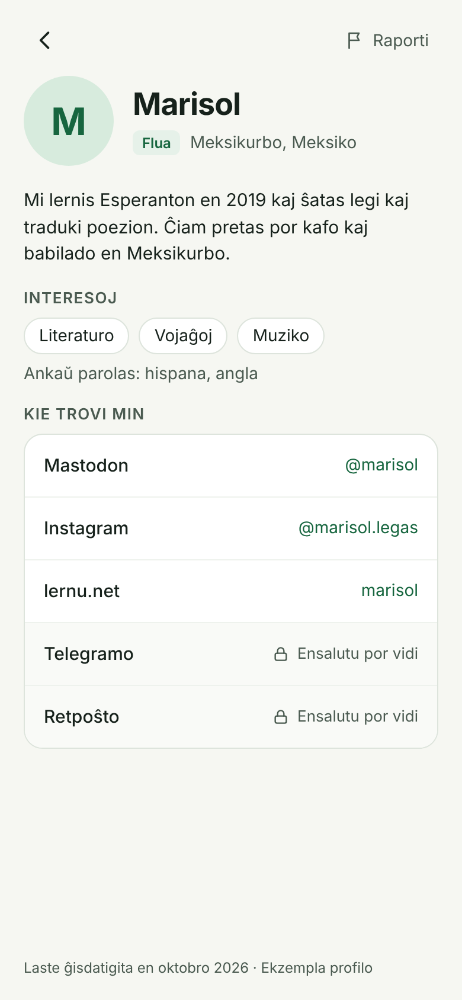
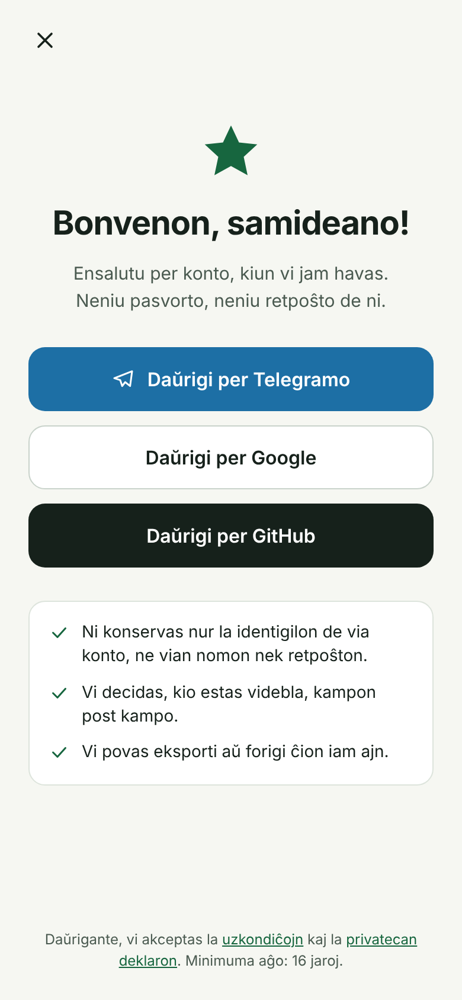
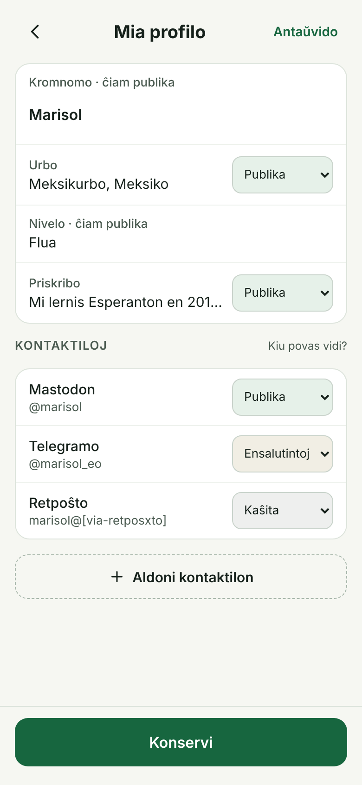
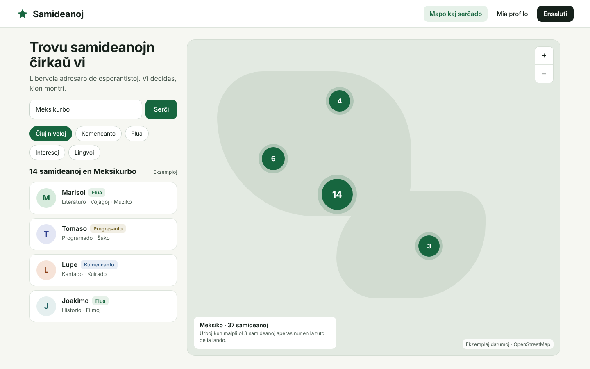
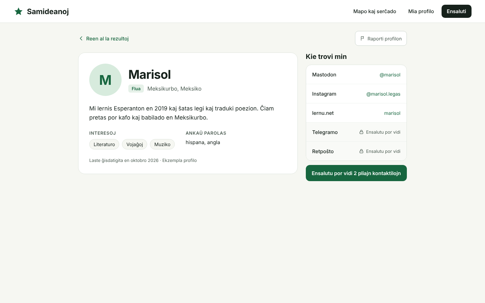
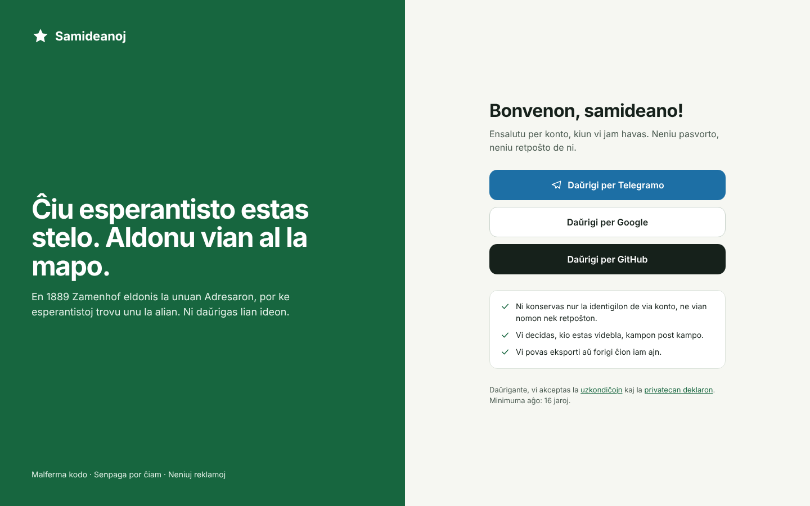
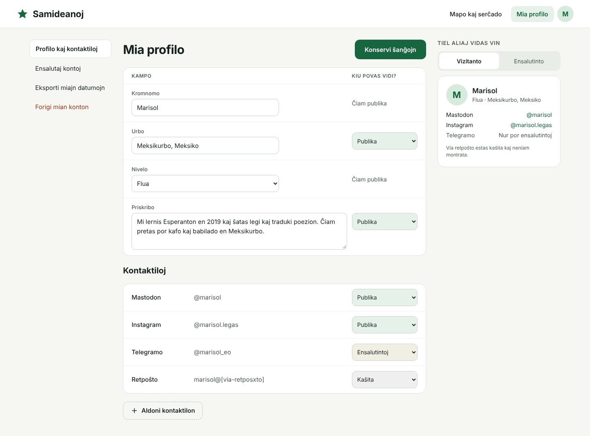

# Prototipo

Statika, navigebla prototipo de la ĉefaj ekranoj de Samideanoj, en du versioj: poŝtelefono kaj labortablo. Ĉiuj datumoj (nomoj, urboj, nombroj) estas ekzemploj.

**Kiel uzi ĝin:** elŝutu aŭ klonu la deponejon kaj malfermu [`index.html`](index.html) en via retumilo. La ekranoj estas ligitaj inter si, do vi povas navigi kiel en la vera retejo.

La fluoj, kiujn ĉi tiuj ekranoj kovras, estas priskribitaj en [`../uzantaj-fluoj.md`](../uzantaj-fluoj.md).

## Poŝtelefono

| Hejmpaĝo kun mapo | Serĉado | Publika profilo |
| --- | --- | --- |
|  |  |  |

| Ensaluto | Redakti profilon |
| --- | --- |
|  |  |

## Labortablo

Sur granda ekrano la mapo kaj la serĉado kuniĝas en unu paĝo.

### Hejmpaĝo kaj serĉado

### Publika profilo

### Ensaluto

### Redakti profilon

## Vida identeco

| Elemento | Valoro |
| --- | --- |
| Simbolo | La verda stelo de Esperanto |
| Ĉefa koloro | `#17663F` |
| Teksto | `#16211B` |
| Fono | `#F6F7F2` |
| Titoloj | Space Grotesk |
| Korpa teksto | Inter |

Ambaŭ tiparoj subtenas la Esperantajn literojn (ĉ, ĝ, ĥ, ĵ, ŝ, ŭ).
