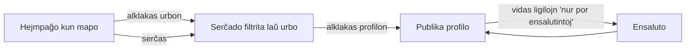
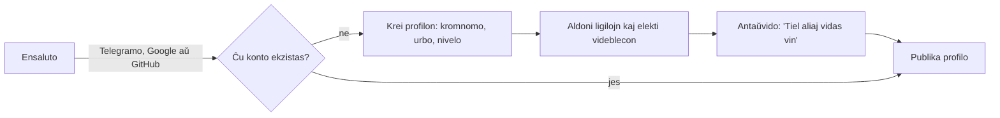
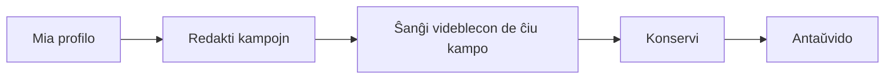
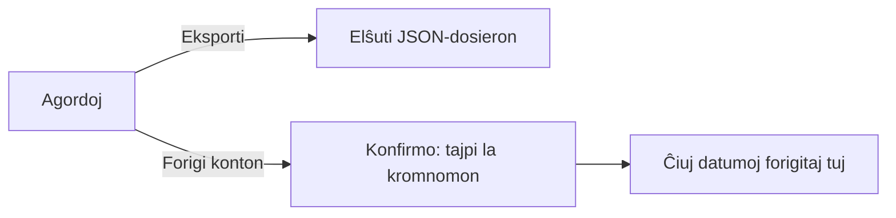
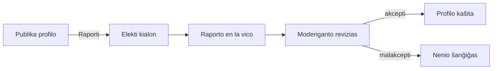

# Uzantaj fluoj

- **Stato:** Skizo por diskuto
- **Dato:** 2026-11-27

Kvin fluoj kovras ĉiujn "Must"-rakontojn de la [PRD](../fazo-1/prd.md).

## Ekranoj

| Ekrano | Adreso | Rakontoj |
| --- | --- | --- |
| Hejmpaĝo kun mapo | `/` | M6 |
| Serĉado | `/sercxi` | M5 |
| Publika profilo | `/s/<slug>` | M3, M4, S1, S3 |
| Ensaluto | `/ensaluti` | M1 |
| Redakti profilon | `/mia-profilo` | M2, M3, M4 |
| Agordoj: eksporti kaj forigi | `/agordoj` | M7 |
| Moderigado | `/moderigado` | M8 |

## 1. Vizitanto malkovras samideanojn

La vizitanto vidas la publikajn kampojn sen konto. Kiam kampo estas "nur por ensalutintoj", ri vidas la tipon de la ligilo (ekz. "Telegramo") kun invito ensaluti, ne la valoron.

## 2. Novulo aliĝas kaj kreas profilon

- La unua paŝo petas nur tri kampojn; ĉio alia estas nedeviga kaj aldonebla poste.
- La antaŭvido montras la profilon kiel vizitanto kaj kiel ensalutinto vidus ĝin, antaŭ ol publikigi.

## 3. Uzanto redaktas profilon

## 4. Uzanto eksportas aŭ forigas sian konton

## 5. Raporto kaj moderigado

